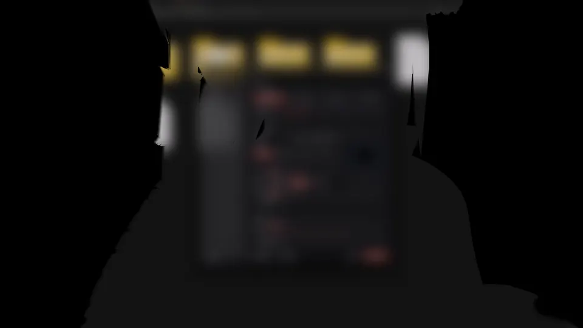
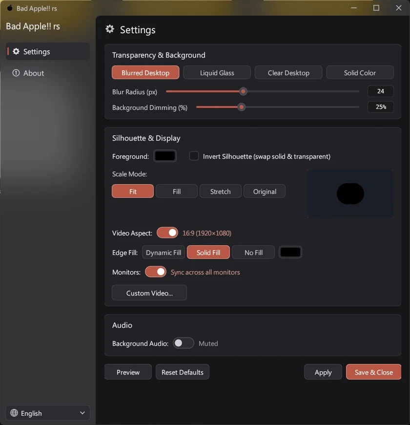

[繁體中文](README.md) | [English](README.en.md) | [日本語](README.ja.md)

# Bad Apple!! rs

A native 64-bit Rust **Bad Apple!! rs** screensaver (`.scr`) for **Windows 11**, featuring transparent blurred desktop backgrounds, Liquid Glass dynamic refraction, and aligned 16:9 / 4:3 playback.

## Preview





---

## Architecture & Refactoring

- **Rewritten from Legacy 32-bit `.NET Framework` to Native 64-bit Rust**:
  - The legacy `BadApple!!.scr` (.NET 4.0 WinForms `UpdateLayeredWindow` + 176 MB resource DLL) and `BadApple.scr` (.NET 2.0/3.0 WPF) suffered from high-DPI misalignment on Windows 11, legacy runtime dependencies, and lack of background blur in transparent regions.
  - Built in pure Rust as a single standalone `BadAppleScreenSaver.scr` executable with no `.NET` or external codec DLLs required.
- **Windows Media Foundation Hardware Decoding**:
  - Uses `IMFSourceReader` (`MFVideoFormat_NV12`) to hardware-decode H.264 MP4 luminance planes directly into silhouette masks, supporting arbitrary resolutions (1080p / 2K / 4K) and TV-range (`16–235`) anti-aliased expansion.
- **Native Windows 11 Screensaver Protocol & High DPI**:
  - Full support for `/s` (fullscreen), `/c` (settings), and `/p <HWND>` (preview), with `PerMonitorV2` DPI awareness and per-monitor output control.

---

## Design Highlights

- **Transparency & Background Styles**:
  - **Blurred Desktop**: Captures each monitor's desktop at startup and applies downsampled 3-pass Gaussian-approximated box blur with bilinear upsampling and adjustable dimming.
  - **Liquid Glass**: Keeps character silhouettes crisp and sharp while computing a 3D height-field normal map around Touhou silhouettes to dynamically refract and ripple the blurred desktop backdrop.
  - **Clear Desktop / Solid Color**: Supports direct transparent pass-through and solid color backgrounds.
- **Anti-Flicker L/R Edge Dynamic Fill (Enabled by Default)**:
  - Uses 16-frame lookahead and >50% screen luminance hysteresis tracking so left and right outer regions follow scene transitions smoothly without flicker.
- **Aligned 16:9 / 4:3 Playback & Anti-Aliased Scaling**:
  - Bundles timeline- and quality-aligned **16:9 (AI Extended · 1920×1080)** and **4:3 (HD Cropped · 1440×1080)** MP4 versions with synchronized audio, sharpened bilinear scaling, multi-monitor sync, and custom `.mp4` / `.mp3` / `.wav` / `.ogg` support.

---

## Sources & Credits

- **Original PV**: `sm8628149 - 【東方】Bad Apple!!　ＰＶ【影繪】` (https://www.nicovideo.jp/watch/sm8628149)
- **Original Wallpaper / Screensaver Authors**:
  - `jun` (`BadApple!!_1.0.3`)
  - `Grey_Lee` (`BadAppleScr2` / http://blog.bcse.tw/bad-apple-screensaver-2)
- **4:3 Video Source**: https://www.bilibili.com/video/BV1x5411o7Kn/
- **16:9 Video Source**: https://www.youtube.com/watch?v=DeYs_ZTzMzA

---

## Build & Installation

### Build
```powershell
cargo test
cargo build --release
New-Item -ItemType Directory -Force -Path dist | Out-Null
Copy-Item -Force target\release\BadAppleScreenSaver-rs.exe dist\BadAppleScreenSaver-rs.scr
```

### Usage & Installation
- **Open Settings**: Double-click `dist\BadAppleScreenSaver-rs.scr`, or right-click and choose **Configure**.
- **Run Immediately**: `dist\BadAppleScreenSaver-rs.scr /s`
- **Install on Windows 11**: Right-click `BadAppleScreenSaver-rs.scr` and choose **Install**, or copy it to `C:\Windows\System32\` and select it in Windows **Change screen saver**.

### Uninstall
- **Automatic (Recommended)**: Run `dist\uninstall.bat` (requests Administrator privileges, stops running processes, deletes `BadAppleScreenSaver-rs.scr` from `System32` / `SysWOW64`, clears `SCRNSAVE.EXE` in Registry, and removes `%APPDATA%\BadAppleScreenSaver`).
- **Manual**:
  1. In Windows **Change screen saver**, switch the screen saver back to `(None)`.
  2. Delete `C:\Windows\System32\BadAppleScreenSaver-rs.scr`.
  3. Delete `%APPDATA%\BadAppleScreenSaver`.

---

## License

- **Program Source Code**: Licensed under the **GNU General Public License v3.0 or later (`GPL-3.0-or-later`)** (see [GNU GPL v3.0](https://www.gnu.org/licenses/gpl-3.0.html)).
- **Media & Asset Rights**: All rights to the bundled or referenced video, audio tracks, music, and related character/derivative works remain with their respective original creators and sources, and are **not** covered by `GPL-3.0-or-later`.
- **Disclaimer**: This program is distributed in the hope that it will be useful, but WITHOUT ANY WARRANTY; without even the implied warranty of MERCHANTABILITY or FITNESS FOR A PARTICULAR PURPOSE.
