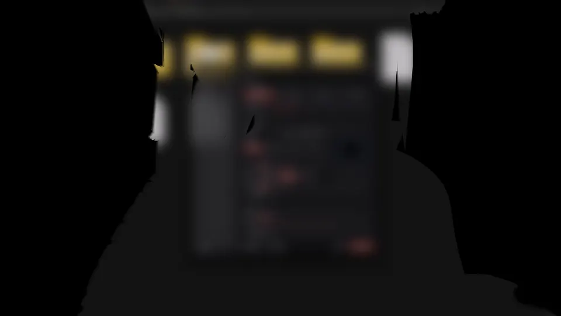
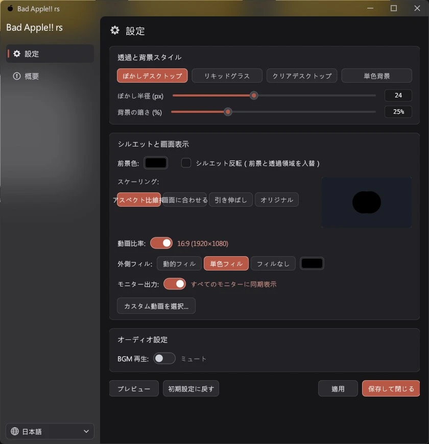

[繁體中文](README.md) | [English](README.en.md) | [日本語](README.ja.md)

# Bad Apple!! rs

**Windows 11** 向けのネイティブ 64-bit Rust 製 **Bad Apple!! rs** スクリーンセーバー（`.scr`）です。透過デスクトップぼかし、リキッドグラス（Liquid Glass）動的背景屈折、16:9 / 4:3 同期済みデュアルフォーマット再生に対応しています。

## プレビュー





---

## アーキテクチャ刷新

- **旧来の 32-bit `.NET Framework` からネイティブ 64-bit Rust へ全面刷新**：
  - 旧版 `BadApple!!.scr`（.NET 4.0 WinForms `UpdateLayeredWindow` + 176 MB リソース DLL）および `BadApple.scr`（.NET 2.0/3.0 WPF）は、Windows 11 における高 DPI ズレ、旧ランタイム依存、透過領域のぼかし非対応などの課題がありました。
  - 純粋な Rust で開発し、`.NET` や外部コーデック DLL を一切必要としない単一実行ファイル `BadAppleScreenSaver.scr` を生成します。
- **Windows Media Foundation ハードウェアデコード**：
  - `IMFSourceReader`（`MFVideoFormat_NV12`）を用いて H.264 MP4 の輝度プレーンを直接ハードウェアデコードし、任意の解像度（1080p / 2K / 4K）および TV-range（`16–235`）アンチエイリアス拡張に対応しています。
- **Windows 11 標準スクリーンセーバープロトコル・高 DPI 対応**：
  - `/s`（全画面）、`/c`（設定）、`/p <HWND>`（システムプレビュー）に完全対応し、`PerMonitorV2` DPI スケーリングおよびマルチモニター個別出力制御を備えています。

---

## 設計の特徴

- **透過と背景スタイル**：
  - **ぼかしデスクトップ**：起動時に各モニターのデスクトップをキャプチャし、ダウンサンプル + 3-pass ガウス近似ボックスぼかしとバイリニアアップサンプルで背景を生成し、暗さの調整も可能です。
  - **リキッドグラス（Liquid Glass）**：キャラクターのシルエット本体の輪郭をくっきり保ちながら、東方キャラクターの 3D ハイトフィールド法線マップを生成して周囲のぼかし背景を動的に屈折・揺らぎ表現します。
  - **クリアデスクトップ / 単色背景**：透過スルー表示と単色背景モードにも対応しています。
- **フリッカー防止の左右動的フィル（初期設定で有効）**：
  - 16 フレーム先読みと画面 1/2 超の輝度ヒステリシス追跡により、左右の外周領域が本編の場面転換に滑らかに追従し、ちらつきを完全に防ぎます。
- **16:9 / 4:3 同期再生とアンチエイリアス拡大**：
  - タイムラインと画質を揃えた **16:9（AI 拡張フル · 1920×1080）** と **4:3（高画質クロップ · 1440×1080）** の 2 バージョン MP4 および同期音声を内蔵し、シャープ化バイリニア拡大、マルチモニター同期、外部 `.mp4` 動画・`.mp3` / `.wav` / `.ogg` 音声再生に対応しています。

---

## オリジナル出典・クレジット

- **オリジナル PV**：`sm8628149 - 【東方】Bad Apple!!　ＰＶ【影繪】`（https://www.nicovideo.jp/watch/sm8628149）
- **オリジナル壁紙／スクリーンセーバー制作者**：
  - `jun`（`BadApple!!_1.0.3`）
  - `Grey_Lee`（`BadAppleScr2` / http://blog.bcse.tw/bad-apple-screensaver-2）
- **4:3 動画出典**：https://www.bilibili.com/video/BV1x5411o7Kn/
- **16:9 動画出典**：https://www.youtube.com/watch?v=DeYs_ZTzMzA

---

## ビルドとインストール

### ビルド
```powershell
cargo test
cargo build --release
New-Item -ItemType Directory -Force -Path dist | Out-Null
Copy-Item -Force target\release\BadAppleScreenSaver-rs.exe dist\BadAppleScreenSaver-rs.scr
```

### 使用方法とインストール
- **設定を開く**：`dist\BadAppleScreenSaver-rs.scr` をダブルクリックするか、右クリックして「構成」を選択します。
- **今すぐスクリーンセーバーを起動**：`dist\BadAppleScreenSaver-rs.scr /s`
- **Windows 11 へのインストール**：`BadAppleScreenSaver-rs.scr` を右クリックして「インストール」を選択するか、`C:\Windows\System32\` にコピーして Windows の「スクリーンセーバーの変更」から選択してください。

### アンインストール方法
- **自動削除（推奨）**：`dist\uninstall.bat` を実行してください（管理者権限を取得し、実行中のプロセス終了、`System32` / `SysWOW64` 内の `BadAppleScreenSaver-rs.scr` 削除、レジストリ `SCRNSAVE.EXE` の解除、`%APPDATA%\BadAppleScreenSaver` の削除を行います）。
- **手動削除**：
  1. Windows の「スクリーンセーバーの変更」で `(なし)` に切り替えます。
  2. `C:\Windows\System32\BadAppleScreenSaver-rs.scr` を削除します。
  3. `%APPDATA%\BadAppleScreenSaver` フォルダを削除します。

---

## ライセンス

- **プログラムソースコード**：本プロジェクトのソースコードは **GNU General Public License v3.0 or later (`GPL-3.0-or-later`)** のもとでライセンスされています（全文は [GNU GPL v3.0](https://www.gnu.org/licenses/gpl-3.0.html) をご参照ください）。
- **映像・音声等の権利について**：本プログラムに内蔵または参照される映像・音源・音楽および関連キャラクター・二次創作物の著作権その他一切の権利は、それぞれの原著作者および出典元に帰属し、`GPL-3.0-or-later` の適用対象**外**です。
- **免責事項**：本プログラムは無保証（商品性や特定目的への適合性を含む一切の明示・黙示の保証なし）で提供されます。
