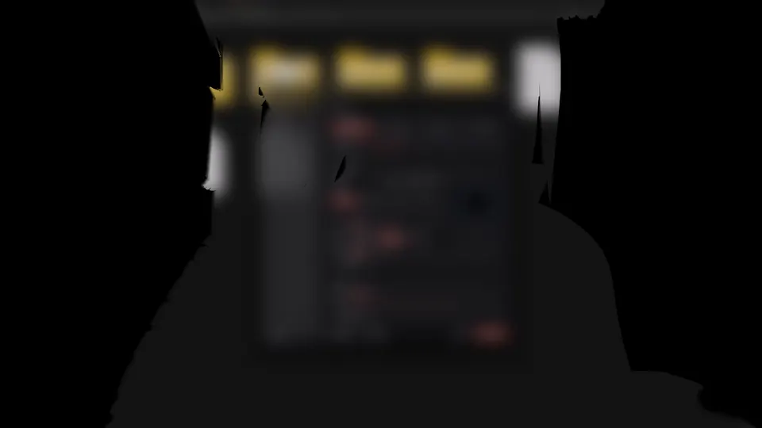
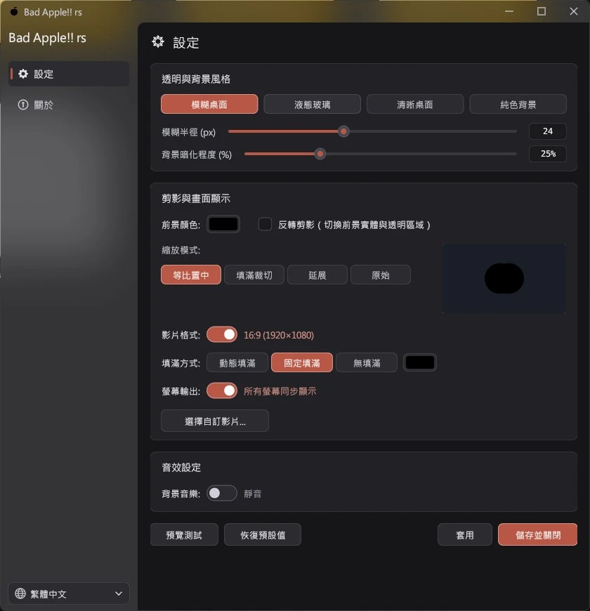

[繁體中文](README.md) | [English](README.en.md) | [日本語](README.ja.md)

# Bad Apple!! rs

適用於 **Windows 11** 的原生 64-bit Rust **Bad Apple!! rs** 螢幕保護程式（`.scr`），支援透明桌面模糊、液態玻璃（Liquid Glass）動態背景折射與 16:9 / 4:3 雙對齊版本播放。

## 效果預覽





---

## 架構調整

- **從舊版 32-bit `.NET Framework` 全面重構為原生 64-bit Rust**：
  - 舊版 `BadApple!!.scr`（.NET 4.0 WinForms `UpdateLayeredWindow` + 176 MB 資源 DLL）與 `BadApple.scr`（.NET 2.0/3.0 WPF）在 Windows 11 上有高 DPI 錯位、依賴舊版執行環境與透明區域缺乏模糊等問題。
  - 新版以純 Rust 開發，產出單一獨立執行檔 `BadAppleScreenSaver.scr`，無須安裝任何 `.NET` 或外部解碼器 DLL。
- **Windows Media Foundation 硬體解碼**：
  - 採用 `IMFSourceReader`（`MFVideoFormat_NV12`）直接硬體解碼 H.264 MP4 亮度平面作為剪影遮罩，並支援任意解析度（1080p / 2K / 4K）與 TV-range（`16–235`）抗鋸齒擴展。
- **Windows 11 原生螢幕保護程式協定與高 DPI**：
  - 完整支援 `/s`（全螢幕）、`/c`（設定介面）、`/p <HWND>`（系統小視窗預覽），並啟用 `PerMonitorV2` DPI 感知與多螢幕獨立輸出控制。

---

## 設計特色

- **透明與背景風格**：
  - **模糊桌面**：啟動時擷取各螢幕桌面，經下採樣 + 3-pass 高斯近似盒狀模糊與雙線性上採樣產生背景，並支援暗化程度調整。
  - **液態玻璃（Liquid Glass）**：剪影本體維持純淨銳利，依東方角色剪影生成 3D 立體高度場法線，對周圍模糊桌面產生動態折射與波動效果。
  - **清晰桌面 / 純色背景**：保留透明直透與純色背景模式。
- **抗閃爍左右動態填滿（預設開啟）**：
  - 透過 16 幀未來幀預讀與超過 1/2 畫面亮度遲滯追蹤，分別控制左右兩側外圍區域跟隨主畫面轉場，徹底消除閃爍。
- **16:9 / 4:3 雙對齊版本與抗鋸齒縮放**：
  - 內建已對齊時間軸與畫質的 **16:9（AI 延伸滿版 · 1920×1080）** 與 **4:3（高畫質裁切 · 1440×1080）** 雙版本 MP4 及同步音軌，並支援雙線性銳化縮放、多螢幕同步輸出與自訂外部 `.mp4` 影片／`.mp3`、`.wav`、`.ogg` 音訊。

---

## 原始來源與致謝

- **原始 PV 來源**：`sm8628149 - 【東方】Bad Apple!!　ＰＶ【影繪】`（https://www.nicovideo.jp/watch/sm8628149）
- **原始桌布／螢幕保護程式設計者**：
  - `jun`（`BadApple!!_1.0.3`）
  - `Grey_Lee`（`BadAppleScr2` / http://blog.bcse.tw/bad-apple-screensaver-2）
- **4:3 影片來源**：https://www.bilibili.com/video/BV1x5411o7Kn/
- **16:9 影片來源**：https://www.youtube.com/watch?v=DeYs_ZTzMzA

---

## 建置與安裝

### 建置
```powershell
cargo test
cargo build --release
New-Item -ItemType Directory -Force -Path dist | Out-Null
Copy-Item -Force target\release\BadAppleScreenSaver-rs.exe dist\BadAppleScreenSaver-rs.scr
```

### 使用與安裝
- **開啟設定**：雙擊 `dist\BadAppleScreenSaver-rs.scr`，或在檔案上按右鍵選擇「設定」。
- **立即執行螢幕保護程式**：`dist\BadAppleScreenSaver-rs.scr /s`。
- **安裝至 Windows 11**：在 `BadAppleScreenSaver-rs.scr` 按右鍵選擇「安裝」，或將檔案複製到 `C:\Windows\System32\` 後於 Windows「變更螢幕保護程式」設定中選取。

### 移除方式
- **自動移除（建議）**：執行 `dist\uninstall.bat`（會自動請求系統管理員權限、停止執行中程式、刪除 `System32` / `SysWOW64` 內的 `BadAppleScreenSaver-rs.scr`、清除登錄檔 `SCRNSAVE.EXE` 與 `%APPDATA%\BadAppleScreenSaver` 設定檔）。
- **手動移除**：
  1. 在 Windows「變更螢幕保護程式」中將螢幕保護裝置切回「(無)」。
  2. 刪除 `C:\Windows\System32\BadAppleScreenSaver-rs.scr`。
  3. 刪除設定資料夾 `%APPDATA%\BadAppleScreenSaver`。

---

## 授權條款

- **程式原始碼授權**：本專案之程式原始碼採用 **GNU General Public License v3.0 or later (`GPL-3.0-or-later`)** 授權（完整條款請見 [GNU GPL v3.0](https://www.gnu.org/licenses/gpl-3.0.html)）。
- **影音與素材權利聲明**：本程式所內建、隨附或引用之影片、音軌、音樂及相關角色／二次創作內容，其著作權與相關權利均歸各自原始創作者與原始來源所有，**不適用** `GPL-3.0-or-later` 授權。
- **免責聲明**：本程式依「現狀」提供，不附帶任何明示或默示之擔保（包含但不限於適售性或特定用途適用性）。
